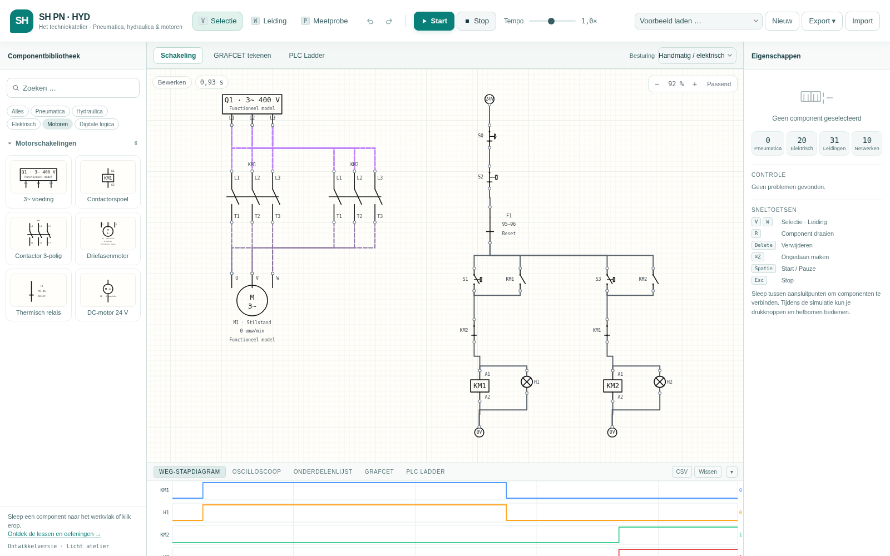
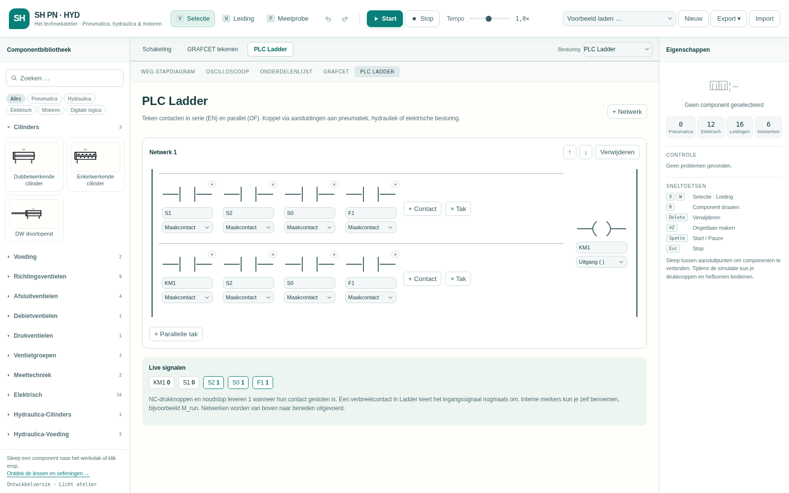
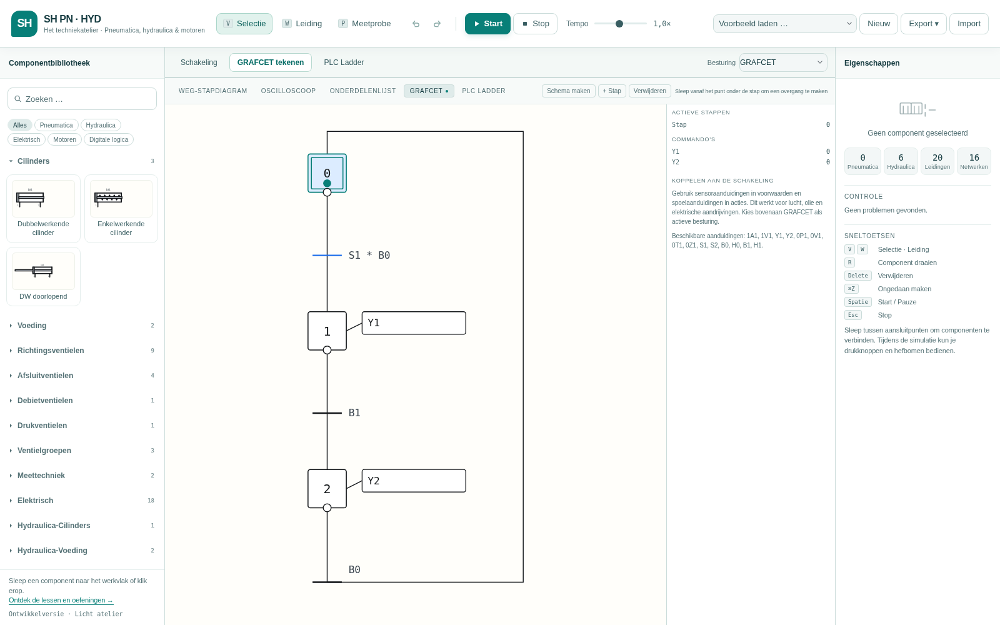
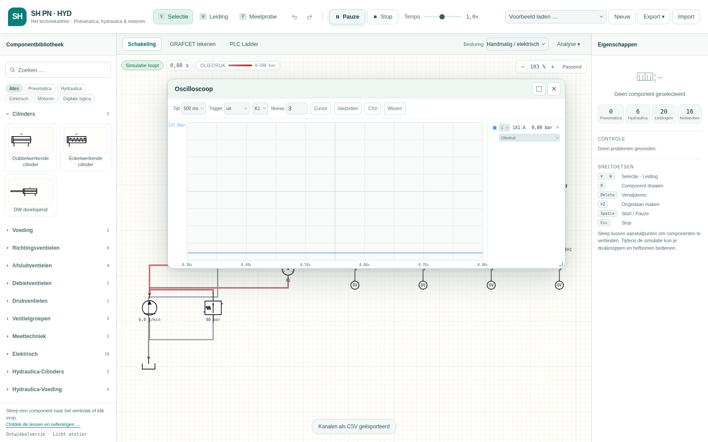

# SH PN · HYD

**[Open de simulator — Licht atelier + motoren](https://dhrhermans.github.io/SHPNHYD/?v=lichtatelier-motoren-2)** · [Lessen en oefeningen](https://dhrhermans.github.io/SHPNHYD/lessen.html?v=lichtatelier-motoren-2)

GitHub toont hier de bronbestanden. De simulator draait via de bovenstaande website. Onderaan de componentbibliotheek staat het geladen versienummer; met **Motoren** open je de zes motorcomponenten.

Nederlandstalige onderwijssimulator voor **pneumatica, hydraulica, elektropneumatica en elektrohydraulica**, op één gezamenlijk werkvlak.

Onderwijsversie voor Stijn Hermans, gebaseerd op [FluidLab van Alexander Hahn](https://github.com/alex-hahn/fluidlab). De oorspronkelijke simulatiekern is behouden. Dit is een afgeleide versie; er zijn geen FluidSIM-programmabestanden of -bibliotheken in opgenomen.

## Wat is aangepast?

- Nederlandse interface, componentnamen, instellingen, voorbeelden en exports.
- Titel **SH PN · HYD**.
- Elektrische eindschakelaars en naderingssensoren kunnen zowel pneumatische als hydraulische cilinders selecteren. De oorspronkelijke keuzelijst sloot hydraulische cilinders uit.
- Bij de cilinderkeuze staat het soort cilinder vermeld.
- Uitleg in het eigenschappenpaneel over sensorkoppeling en ventielspoelen.
- Nieuw startvoorbeeld: **Elektrohydraulica: cilinder met eindschakelaars**.
- De oorspronkelijke netwerkberekeningen, 80 componenten, GRAFCET, exports en tests zijn behouden; zes eigen motorcomponenten breiden de bibliotheek uit tot 86 componenten.

## Publiceren via GitHub Pages

De bestanden staan al in `DHRHermans/SHPNHYD`. Gebruik één publicatieroute:

1. Open **Settings → Pages** in deze repository.
2. Kies bij **Build and deployment → Source** voor **GitHub Actions** (niet voor publicatie vanaf een branch).
3. Open **Actions → GitHub Pages** en controleer of de uitvoering bij de nieuwste commit groen is. Alleen een groene **CI**-test betekent nog niet dat de website is bijgewerkt.
4. Open de simulator via de link bovenaan deze README. De actie publiceert het lichte thema, de motorcatalogus en de lespagina samen.

De publicatie geeft CSS en alle JavaScript-modules een inhoudsgebonden assetpad. Zo gebruikt een nieuwe websiteversie geen oude componentbibliotheek uit de browsercache. De geladen versie staat onderaan de componentbibliotheek en in `version.json`. Zie je daar nog geen versie of zie je geen knop **Motoren**, controleer dan of je de eigen SHPNHYD-website opent en of de nieuwste **GitHub Pages**-uitvoering is afgerond. Een eenmalige harde verversing kan nodig zijn als de browser nog het oude HTML-document heeft.

Er is geen database of account voor leerlingen nodig. De publicatie gebruikt alleen Node.js; er worden geen pakketten geïnstalleerd.

## Lokaal openen

Gebruik een lokale webserver, omdat de toepassing JavaScript-modules laadt. Enkel dubbelklikken op `index.html` werkt niet betrouwbaar.

```sh
python3 -m http.server 8777
```

Open daarna `http://localhost:8777`. Op Windows kan `py -m http.server 8777` worden gebruikt. Met VS Code kan ook de extensie Live Server worden gebruikt.

De toepassing haalt geen externe lettertypen of JavaScript-bibliotheken op. Er worden geen leerlinggegevens naar een server gestuurd. Een tekening bewaar je zelf via **Export → Schakelschema (JSON)** en open je met **Import**.

## Elektrohydraulica proberen

Het elektrohydraulische voorbeeld opent automatisch.

1. Klik **Start**.
2. Houd drukknop **S1** ingedrukt: spoel **Y1** bekrachtigt het 4/3-ventiel en de cilinder schuift uit.
3. Laat S1 los: het ventiel keert terug naar de gesloten middenstand.
4. Houd **S2** ingedrukt: spoel **Y2** laat de cilinder inschuiven.
5. **B0** bewaakt de ingeschoven positie, **B1** de uitgeschoven positie. Ze schakelen signaallampen **H0/H1**.

Klik op B0 of B1. Onder **Eigenschappen → Cilinder** kun je de hydraulische cilinder kiezen. Positie **0** betekent ingeschoven; **1** betekent uitgeschoven.

Elektrische draden sluiten aan op elektrische componenten. Olieleidingen sluiten aan op de hydraulische poorten. Een ventielspoel en het ventiel werken samen via dezelfde aanduiding, bijvoorbeeld **Y1**. Een eindschakelaar wordt via de instelling **Cilinder** aan de beweging gekoppeld. Je tekent dus geen elektrische draad naar een oliepoort op de cilinder.

Zie [de Nederlandse handleiding](docs/HANDLEIDING-NL.md).

## Testen

Node.js 18 of nieuwer:

```sh
npm test
```

Naast de oorspronkelijke 92 tests zijn vijf regressietests toegevoegd voor de cilinderkeuze, elektrische sensoren op een hydraulische cilinder, een volledige uit-/inschuifcyclus het bewaren van sensorkoppelingen bij opslaan/openen en de pneumatische vrijgave van hydraulische beweging. Tekstverwachtingen in bestaande tests zijn aangepast aan de Nederlandse meldingen.

## Herkomst en licentie

Required Notice: Copyright 2026 Alexander Hahn <alexanderhahn.br@gmail.com>

De code valt onder de oorspronkelijke **PolyForm Noncommercial 1.0.0**-licentie. Zie [LICENSE](LICENSE). Bewaar deze licentie en auteursvermelding bij verspreiding. De onderwijsaanpassingen veranderen de oorspronkelijke licentie niet.

Onderwijsgebruik is expliciet opgenomen in die licentie. Commercieel gebruik vereist een afzonderlijke schriftelijke licentie van de oorspronkelijke rechthebbende. Dit is broncode die beschikbaar is onder niet-commerciële voorwaarden, geen onbeperkte opensourcelicentie.

De oorspronkelijke technische documentatie blijft beschikbaar in `docs` en `README.de.md`. De oorspronkelijke Engelstalige README staat in [docs/UPSTREAM-README.md](docs/UPSTREAM-README.md).

Upstream-commit: `0c218f4e06e187bb0f21527a8bef6f2d2cd2baf7`.

## Grenzen

Dit is een onderwijsmodel. De bestaande modelgrenzen blijven gelden: de hydraulische bibliotheek is beperkter dan een volledige industriële simulator, leidingen en olie worden vereenvoudigd gemodelleerd en de externe WebSocket-I/O is een stub. Zie [docs/LIMITATIONS.md](docs/LIMITATIONS.md). Er is geen rechtstreekse import van FluidSIM `.ct`-bestanden toegevoegd.

## Gemengde lesoefening en automatische publicatie

Het menu **Voorbeeld laden** bevat nu **Gemengd: pneumatische vrijgave voor elektrohydraulica**.
Een pneumatische eindstandsensor geeft daarin hydraulisch uitschuiven vrij via de elektrische besturing.
Zie de [Nederlandse handleiding](docs/HANDLEIDING-NL.md#gemengde-oefening-pneumatische-vrijgave-voor-elektrohydraulica).

Voor deze repository is een GitHub Pages-workflow toegevoegd. Kies in **Settings → Pages → Source** de optie **GitHub Actions**.
Na plaatsing van de bestanden op `main` voert deze workflow eerst de simulatietests uit en publiceert bij succes de website.
De workflow kan ook handmatig worden gestart via **Actions → GitHub Pages → Run workflow**.
Gebruik de hierboven beschreven GitHub Actions-route; zo worden de versiegebonden bestanden gepubliceerd.

## Licht atelier, motorbesturing en lessen

De eigen lichte vormgeving gebruikt witte panelen, een warm tekenblad en blauwgroene accenten. Open [het lesoverzicht](lessen.html) voor dertien Nederlandse opdrachten met directe links naar hun voorbeeldschakeling.

Via **Motoren** vind je een driefasenvoeding, contactorspoel, driepolige hoofdcontacten, driefasenmotor, thermisch relais en 24 V-DC-motor. Nieuwe voorbeelden behandelen direct starten met zelfhouding, elektrisch en mechanisch vergrendelde omkeersturing en een transportband. De driefasenhoofdkring is een functioneel verbindingsmodel; toerental, stroomschatting en thermische uitschakeling zijn didactisch vereenvoudigd. Een echte AC-motorberekening, ster-driehoek en frequentieregelaars zijn nog niet beschikbaar.



Zie [de Nederlandse handleiding](docs/HANDLEIDING-NL.md#industriële-motorschakelingen) voor bediening en modelgrenzen, en [het referentieonderzoek](docs/REFERENTIES.md) voor het gebruik van de aangeleverde FluidSIM-archieven. Originele FluidSIM-programma's en oefenbestanden zijn niet overgenomen.

## GRAFCET en PLC Ladder tekenen

Boven het werkvlak staan nu **Schakeling**, **GRAFCET tekenen** en **PLC Ladder**. GRAFCET heeft een groot tekenvlak voor stappen, overgangen en acties. In de grafische Ladder-editor bouw je serie- en parallelcontacten, uitgangsspoelen, set/reset en TON/TOF-vertragingen. Kies bovenaan één actieve besturing.

Beide besturingen werken met dezelfde sensoren en spoelaanduidingen voor **pneumatiek, hydrauliek en elektrische motoren**. Zes nieuwe voorbeelden tonen elk van deze combinaties. JSON-export en undo/redo bewaren het programma en de besturingskeuze. Zie de [bedieningsuitleg](docs/HANDLEIDING-NL.md#werkbladen-voor-grafcet-en-plc-ladder).




## Groter tekenvlak en losse analysevensters

De onderste analysebalk is vervangen door **Analyse → Weg-stapdiagram / Oscilloscoop / Onderdelenlijst**. Deze hulpmiddelen openen als verplaatsbare vensters met een aanpasbaar formaat, een vergrootknop en een sluitknop. Meerdere vensters kunnen tegelijk open terwijl de simulatie doorgaat. GRAFCET en PLC Ladder behouden hun eigen grote werkblad.


