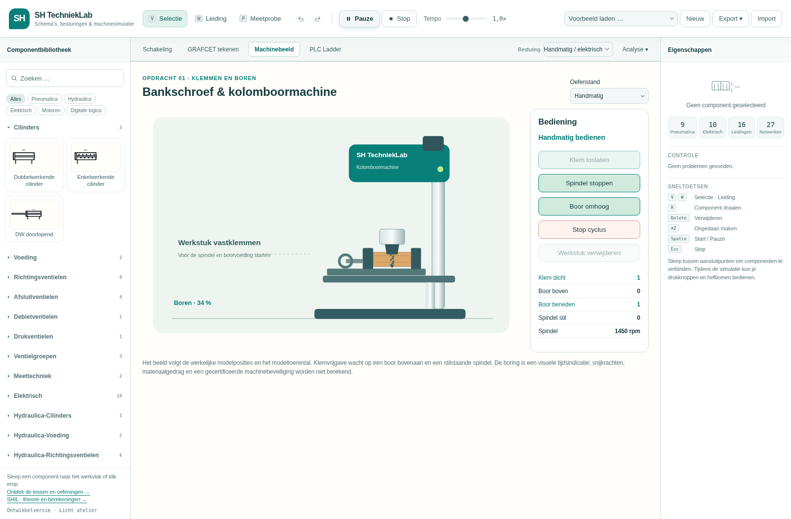

# SH TechniekLab

**Schema’s, besturingen & machinesimulatie** — een Nederlandstalig techniekatelier voor onderwijs.

**[Open SH TechniekLab](https://dhrhermans.github.io/SHPNHYD/)** · [Lessen en opdrachten](https://dhrhermans.github.io/SHPNHYD/lessen.html) · [SHIL: theorie en berekeningen](https://dhrhermans.github.io/SHIL/)

De vroegere naam was **SH PN · HYD**. De repository blijft `DHRHermans/SHPNHYD`; bestaande links en JSON-schakelingen blijven bruikbaar.

## Wat kun je ermee?

- Pneumatiek, hydrauliek, elektrische besturing, elektronica en motoren combineren op één werkvlak: **119 componenten en 39 voorbeelden**.
- Ventielbediening, veer/geheugen en beschikbare middenstanden kiezen. Als extra kun je per stand interne verbindingen tussen bestaande poorten tekenen.
- GRAFCET tekenen en PLC Ladder opbouwen met contacten, parallelle takken, spoelen, set/reset en TON/TOF-timers.
- Een **PLC- of GRAFCET-module met 8 ingangen en 8 uitgangen** in het schema plaatsen en elektrisch bedraden.
- Motoratelier: 230 V-monofasemotor, zespolige ster-/driehoekmotor, tijdcontacten, temperatuurcontact/PT100, instelbare automaten en motorbeveiliging.
- Mechanische motorassen voor belastingen, vliegwielen, hydraulische pompen en compressoren; netkeuze TN-S/TN-C/TN-C-S/TT/IT.
- **Leeratelier** met zes begeleide opdrachten, onderdeeluitleg, echte stapbediening, meetgereedschap, diagnose en storingszoeken — zonder aparte rollen.
- Automatisch lokaal werkherstel met vier vorige versies; bewaarde opdrachttekst, metingen, momentopnamen en simulatie-indeling.
- Simulatiekaarten verslepen, vergroten/verkleinen en groeperen; berekende energieactiviteit tonen in ondersteunde leidingen.
- Eén groot simulatiescherm of een apart venster voor een tweede monitor, met machine, bediening, aandrijvingen en eigen transportknoppen.
- Fysiek afgebeelde drukknoppen en handventielen direct bedienen in Machinebeeld; automatische ventielen, sensoren, spoelen en overige onderdelen volgen dezelfde schematoestand.
- Automatisch bewegende beelden van alle pneumatische/hydraulische cilinders en driefasen-/DC-motoren uit je schema, inclusief slag, druk, toerental en draairichting.
- In **Machinebeeld** zelf een kolombooropstelling bouwen: onderdelen plaatsen en verslepen, eigen cilinders/motor/signalen koppelen en zelf GRAFCET of Ladder tekenen. Het beeld volgt jouw schema; een uitgewerkt lesvoorbeeld is apart beschikbaar.
- Oscilloscoop, weg-stapdiagram en onderdelenlijst als verplaatsbare analysevensters openen.
- Schema’s bewaren als JSON, exporteren als SVG/PNG/PDF en afdrukken **met SH-logo**. Ook GRAFCET, Ladder en het machinebeeld hebben een afdrukvoorbeeld.



## Snel beginnen

1. Open de website en kies een voorbeeld.
2. Gebruik **Schakeling**, **GRAFCET**, **PLC Ladder** of **Machinebeeld** voor het gewenste werkblad.
3. Kies bovenaan de actieve besturing: handmatig/elektrisch, GRAFCET of Ladder.
4. Start de simulatie. Componenten en eindschakelaars gebruiken aanduidingen zoals `Y1`, `B0` en `KM1`.
5. Kies **Analyse** voor losse meetvensters en **Export** voor opslaan of afdrukken.

Kies **Machinebeeld: zelf een opstelling bouwen** voor een leeg schema en procesbeeld zonder ingevulde besturing. Plaats onderdelen en koppel jouw eigen schema. Wil je een uitgewerkt voorbeeld bekijken, kies dan **Machinebeeld: bankschroef en kolomboormachine**. Oefen handmatig en kies daarna in het procesbeeld **Automatisch · GRAFCET** of **Automatisch · PLC Ladder**. De cyclus klemt, start de spindel, boort, trekt terug, stopt de spindel en geeft het werkstuk vrij.

Voor fysiek bedrade besturing kies je **PLC: fysiek bedrade module met cilinder** of het overeenkomstige GRAFCET-voorbeeld. `L+` en `M` zijn nodig voor de voeding; `I0–I7` lezen 24 V-ingangssignalen en `Q0–Q7` voeden spoelen of lampen. Ontbrekende draden worden niet virtueel overbrugd.

Zie de [Nederlandse handleiding](docs/HANDLEIDING-NL.md) voor alle functies, de [modelgrenzen](docs/LIMITATIONS.md) en de [wijzigingen](CHANGELOG.md).

## Lokaal ontwikkelen

Aanbevolen: **Node.js 22 of 24 LTS** en **Python 3**. De toepassing en tests blijven compatibel met Node.js 18 of nieuwer. Er zijn geen externe npm-pakketten nodig.

```sh
npm test
npm start
```

`npm start` serveert de toepassing op poort 8777. Open lokaal `http://localhost:8777`. JavaScript-modules hebben een webserver nodig; open `index.html` niet door te dubbelklikken.

De tests omvatten **202 controles in 19 testgroepen**, waaronder fysica, elektronica, PLC, GRAFCET, afdrukken, machinevolgorde, bedrade I/O en instelbare ventielen. Zie [TESTING.md](docs/TESTING.md).

## GitHub Pages publiceren

Kies **Settings → Pages → Build and deployment → Source → GitHub Actions**. De workflow **GitHub Pages** test de code, maakt een statische publicatiemap en publiceert die. Alleen een groene **CI**-workflow bewijst nog geen publicatie.

CSS en alle JavaScript-modules krijgen een inhoudsgebonden assetpad. De geladen versie staat onder de bibliotheek en in `version.json`. Voor een lokale publicatiecontrole:

```sh
node scripts/build-site.js /tmp/sh-technieklab-site
```

De uitvoermap moet leeg zijn en buiten de repository liggen. Dit is alleen de publicatiestap; lokaal ontwikkelen vereist geen build.

## SHIL en SH TechniekLab

**SHIL** blijft een afzonderlijke toepassing voor elektrotechnische uitleg, formules, AC/DC, motorberekeningen en inductie. **SH TechniekLab** gebruikt schema’s en besturingen om een proces te laten werken. De apps zijn via een link verbonden; er is geen automatische uitwisseling van instellingen, voortgang of schema’s. Zie [het koppeladvies](docs/SHIL-KOPPELING.md).

## Herkomst, licentie en gegevens

Onderwijsaanpassingen voor Stijn Hermans, gebaseerd op [FluidLab van Alexander Hahn](https://github.com/alex-hahn/fluidlab), upstream-commit `0c218f4e06e187bb0f21527a8bef6f2d2cd2baf7`.

Required Notice: Copyright 2026 Alexander Hahn <alexanderhahn.br@gmail.com>

De oorspronkelijke **PolyForm Noncommercial 1.0.0**-licentie blijft gelden. Onderwijsgebruik is toegestaan onder die voorwaarden; dit is geen onbeperkte opensourcelicentie. Bewaar [LICENSE](LICENSE) en [THIRD-PARTY-NOTICES.md](THIRD-PARTY-NOTICES.md) bij verspreiding.

De toepassing voert haar eigen berekeningen lokaal uit en heeft geen leerlingaccounts, database of externe JavaScript-bibliotheken nodig. Bestanden sla je zelf op; bepaalde werkruimte-instellingen worden in de browser bewaard. SHIL is een externe, afzonderlijke site.

De aangeleverde FluidSIM-archieven zijn als functionele referentie onderzocht. Er zijn geen originele FluidSIM-programma’s, bibliotheken of oefenbestanden opgenomen en er is geen `.ct`-import. Ook PLCioSim-code is niet geïntegreerd; de vernieuwde ladderbediening is eigen code. Zie [REFERENTIES.md](docs/REFERENTIES.md).
